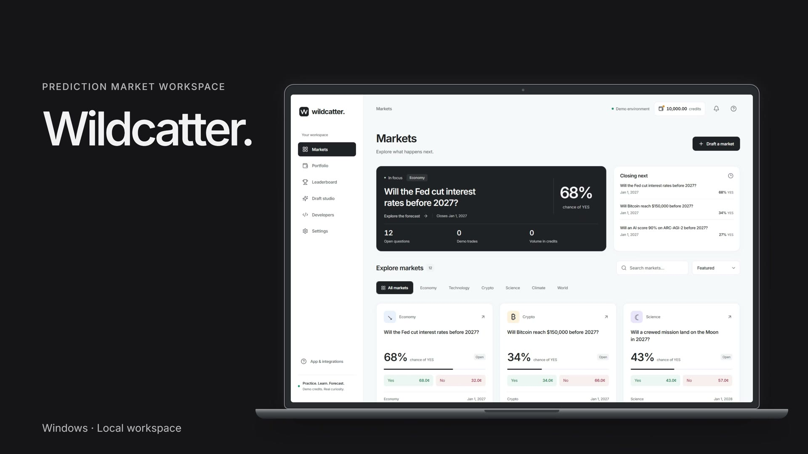

# Wildcatter

**An AI-native prediction market platform.** Anyone can draft a market with AI help, launch it with their own staked liquidity, trade it, and see it resolved through a transparent propose, dispute and rule process. Web, mobile and Windows share the same interface and API contract; web and Android use the hosted service, while Windows includes its own local server and database.

**Live demo:** https://wildcatter-welcome.onrender.com · **API reference:** https://wildcatter-p3yy.onrender.com/api-docs/ · **Windows and Android apps:** [latest release](https://github.com/vinitgirdhar/wildcatter/releases/latest)


A quiet forecasting workspace: crisp typography, a persistent desktop sidebar, and a touch-friendly mobile tab bar. A compact market pulse shows open questions, actual demo activity and upcoming deadlines. The hero offers the web app, Windows desktop download and Android download together. Light and dark appearances, hidden scrollbars that preserve scrolling, section reveals, sliding selections, animated charts and values, expanding panels, and tactile controls work across the shared frontend, with reduced-motion support.

> Wildcatter runs on practice credits. Every new account starts with 5,000 credits after a short onboarding (display name, 18+ confirmation, Terms and Privacy consent). Playground mode is always on; nothing here is real money, a wallet, or an on-chain asset. See [Scope and honesty](#scope-and-honesty).

## Product film

[](public/media/wildcatter-product-introduction.mp4)

**[Watch the product introduction — 1 min 54 sec](public/media/wildcatter-product-introduction.mp4)** · [English captions](public/media/wildcatter-product-introduction.en.vtt)

The film uses real application captures and English narration. Its shared-market update demonstrates the web and mobile clients receiving data from the same backend. Windows keeps a separate local workspace; automatic account or portfolio synchronization with the hosted service is not implemented. All records shown use practice credits, and the refresh interval is compressed for the film.

Music: “Happy Beats / Business Moves, Vol. 12” by Sascha Ende, [ende.app](https://ende.app), under [CC BY 4.0](https://creativecommons.org/licenses/by/4.0/). Android is a trademark of Google LLC. The Android robot is reproduced or modified from work created and shared by Google and used according to terms described in the [Creative Commons 3.0 Attribution License](https://creativecommons.org/licenses/by/3.0/). Windows is a trademark of Microsoft Corporation.

Video production files, source captures, narration sources and intermediate renders are local and gitignored. The repository contains only the final web video and its playback assets.

## Contents

- [What it does](#what-it-does)
- [Design principles](#design-principles)
- [Delivery phases](#delivery-phases)
- [Architecture](#architecture)
- [Run it locally](#run-it-locally)
- [Apps: web, mobile, Windows](#apps-web-mobile-windows)
- [Developer API](#developer-api)
- [Quality and verification](#quality-and-verification)
- [Deployment](#deployment)
- [Scope and honesty](#scope-and-honesty)
- [Documentation](#documentation)

## What it does

### Trade

- Search, filter and sort markets; each shows its YES probability, 24-hour change, volume and deadline.
- Buy and sell YES/NO shares against an LMSR automated market maker with live quotes, a price-impact breakdown and a slippage limit.
- **Limit orders**: name a price and the order fills by itself when the market reaches it.
- **Explain this market**: every market page says what its number means in plain words ("The crowd puts this at about 1 in 3"), with the 24-hour move, activity, time left, how it resolves and the launch rule check, computed without AI. Where AI is configured, an optional explainer adds drivers, what would move the price up or down, a base-rate note and caveats, labelled as AI-generated and not advice.
- Portfolio with positions, profit and loss, trade activity, open orders, watchlist, performance stats and a downloadable CSV statement.

### Create

- **Draft studio**: write a market by hand or let an AI provider (Gemini, Groq, OpenAI or local Ollama) tighten the question and the YES / NO / invalid rules. The source and deadline you set are protected from the model.
- **Rule linter**: a live "Rule check" flags ambiguous rules as you type (a comparison with no number, a creator-as-judge rule, a URL shortener, a missing time zone or deadline). Blocking problems stop the launch; warnings need an acknowledgement and are shown on the launched market. An optional AI critique adds advisory suggestions.
- **Creator markets**: launch a draft as a live market by staking 500 credits of liquidity. The creator earns a 1% fee on every trade and gets unused liquidity back at resolution. The stake fully covers the market maker's worst-case loss, so every payout is funded.

### Resolve

An optimistic-oracle lifecycle, the part most demo markets skip:

1. **Propose.** The creator posts an outcome (YES, NO or INVALID) with an evidence link. Trading halts.
2. **Challenge window.** Anyone else may dispute by posting a 100-credit bond.
3. **Settle.** Undisputed proposals pay out automatically when the window ends.
4. **Rule.** Disputed markets wait for an operator ruling (in a workspace, a resolver's). An overturned creator pays the disputer; an upheld one keeps the bond.

Winning shares redeem for 1 credit, INVALID pays 0.5 on both sides, and every credit movement is written to a per-account ledger.

### Engage

- Public trade feed and discussion on every market; comments show which side the commenter holds.
- Leaderboards for top traders (by profit) and top creators (by fees). Traders appear under an alias, never an account id.
- **Accuracy scoring**: a Brier score ranks forecasters by being right, not by being rich. The Portfolio's Accuracy card shows your score, your skill against the market price and a reliability diagram; the "Most accurate" leaderboard ranks accounts with at least 3 markets resolved YES or NO.
- Notifications inbox for fills, payouts, proposals, disputes and comments.
- Daily bonus with a streak. Bonus credits are excluded from profit rankings.

### Share and embed

- **Share** on any market copies its link or a one-line `<iframe>` embed snippet, with a live preview of the widget.
- **Embeddable widget** at `/embed/markets/{id}`: a small read-only card with the question, YES probability, 24-hour change, sparkline, deadline and status, plus a link back to the market. Light, dark or automatic theme; no JavaScript; any site may frame it.
- **oEmbed** at `/api/v1/oembed`, and market pages carry Open Graph tags, so pasted links unfurl in blogs, chat apps and CMSs.
- The Windows app runs only on this computer, so it shows the preview and points to the hosted app for links and embeds.

### Teams (preview)

Private forecasting for a club, class or team, under **Teams** in the navigation.

- **Workspaces**: create one and you become its owner. Every member gets a separate wallet with 10,000 workspace credits; their own balance is untouched, and workspace credits cannot be moved, bought or redeemed.
- **Invite links**: owners and admins create links that join as a member or resolver, with an expiry (1, 7 or 30 days) and a use limit. A link is shown once; its token sits in the URL fragment (`/join#…`), so it never reaches server logs, and the join page clears it from the address bar. Links can be revoked.
- **Private markets**: in Draft studio, **Launch to** a workspace instead of the public list. The launch stakes 500 wallet credits, and only members can see, trade, discuss or dispute the market; anyone else gets "not found". Private markets have no share link or embed.
- **Roles**: owners manage everything, including ownership transfer; admins manage invites and move people between member and resolver; owners, admins and resolvers rule disputed private markets, unless they created, disputed or hold shares in them. The platform operator never rules a private market.
- **Workspace leaderboard** ranks members by display name on profit, creator fees and accuracy, counting only that workspace's markets.

Teams is labeled a preview: the hosted demo database can reset, and membership belongs to the browser's demo session. The Windows app runs only on one computer, so it hides Teams.

## Design principles

1. **Every payout is funded.** Creator liquidity equals the LMSR worst-case loss, so a market can never owe more than it holds. A test asserts that credits are conserved across a full market lifecycle.
2. **Money is integers.** All amounts are integer microcredits (1 credit = 1,000,000). No floating-point balances.
3. **One atomic write per action.** A trade, its fee, the position change and the ledger row commit together or not at all. Retries are safe through idempotency keys.
4. **AI assists, humans decide.** Models refine wording only. They cannot publish a market, trade, or settle an outcome, and their output is schema-validated before it is saved.
5. **Resolution is a process, not a button.** Outcomes need evidence, can be challenged, and disputes cost a bond, so lying is expensive for both sides.
6. **Private by default.** Account ids never leave the server; public surfaces use stable aliases. Provider keys stay server-side and are never returned by the API.
7. **One API for everyone.** The web app, the desktop app and third-party builders use the same versioned HTTP API and the same typed client.
8. **Claims are tested.** Each feature ships with automated checks, and the docs state what is not covered.

## Delivery phases

| Phase | Theme                                                                                                                             | Status  |
| ----- | --------------------------------------------------------------------------------------------------------------------------------- | ------- |
| 1     | Exchange core: accounts, AMM pricing, atomic trades, portfolio, price history                                                     | Done    |
| 2     | Creation: draft studio, AI rule refinement across four providers, creator markets with staked liquidity and fees                  | Done    |
| 3     | Resolution: proposals with evidence, challenge window, bonded disputes, operator rulings, automatic settlement, credit ledger     | Done    |
| 4     | Product depth: limit orders, discussion, watchlist, leaderboards, notifications, daily bonus, performance stats, statement export | Done    |
| 5     | Surfaces: responsive web, installable mobile PWA, Windows desktop app, public API with OpenAPI and typed SDK, hosted demo         | Done    |
| 6     | Real settlement: wallet connectivity, collateral vault and conditional tokens on an L2 testnet, a full order book                 | Planned |
| 7     | Autonomy and compliance: news ingestion and market generation agents, multi-source oracle, KYC and geofencing, fiat rails         | Planned |

The requirement-by-requirement record against the original brief is in [docs/RFP_STATUS.md](docs/RFP_STATUS.md).

## Architecture

```
            Web app            Mobile PWA           Windows app (Electron)
               \                  |                   /
                +------ shared React UI (src/) ------+
                               |
                   typed client (shared/client.ts)
                               |
                     HTTP API  /api/v1  (Fastify 5)
        +-----------+-----------+-----------+-----------+
        | trading   | creation  | resolution| community |
        | AMM,orders| drafts,AI | disputes  | feed,inbox|
        +-----------+-----------+-----------+-----------+
                               |
                     SQLite (node:sqlite), one file
```

| Folder     | Contents                                                                                    |
| ---------- | ------------------------------------------------------------------------------------------- |
| `src/`     | Shared React 19 UI used by web, PWA and desktop                                             |
| `server/`  | Fastify API, SQLite transactions, AMM, limit orders, resolution, notifications, AI adapters |
| `shared/`  | API types and the TypeScript client used by the UI and by integrators                       |
| `desktop/` | Electron shell: sandboxed renderer, bundled local API                                       |
| `tests/`   | Unit and integration tests (`node:test`) and Playwright browser journeys                    |
| `scripts/` | Verification pipeline, API smoke test, desktop packaging and smoke test                     |
| `docs/`    | API guide, backend guide, design system, plan, RFP status                                   |

**Stack:** TypeScript, Node.js 22 (`node:sqlite`), Fastify 5 with TypeBox schemas, React 19, Vite 8, Electron, Playwright.

## Run it locally

Requires Node.js 22.13 or newer.

```bash
npm ci
npm run build
npm start
```

Open http://127.0.0.1:3001 for the app and http://127.0.0.1:3001/api-docs/ for the interactive API reference. Use `npm run dev` for hot reload.

Optional settings go in `.env` (copy `.env.example`): AI provider keys, `AI_ACCESS_TOKEN` to gate paid AI calls, `OPERATOR_TOKEN` (16 to 256 characters) to enable operator rulings, and `DISPUTE_WINDOW_SECONDS`. Never commit `.env`.

## Apps: web, mobile, Windows

| Surface                  | How to get it                                                                                                                                             | Data                                                                |
| ------------------------ | --------------------------------------------------------------------------------------------------------------------------------------------------------- | ------------------------------------------------------------------- |
| Web                      | The live demo, or `npm start` locally                                                                                                                     | The server it talks to                                              |
| Mobile (Android and iOS) | Open the live demo on the phone and choose **Install app** / **Add to Home Screen**. The PWA runs full screen with its own icon.                          | Same hosted backend as the web demo                                 |
| Windows desktop          | Download the ZIP from the [latest release](https://github.com/vinitgirdhar/wildcatter/releases/latest), extract the whole folder and run `Wildcatter.exe` | Its own bundled local API and database under `%APPDATA%/wildcatter` |

The desktop app is self-contained: it starts its own local server and needs no internet connection except for optional AI providers. Build it yourself with `npm run desktop:package`. The preview executable is unsigned, so Windows SmartScreen may ask for confirmation.

The landing page also offers an Android APK when its download is available. Build the Android shell with `powershell -File scripts/build-android.ps1` (Android SDK 35 and JDK 17 required). The production build opens the always-available warm-up entry before navigating to the hosted market workspace. Use `-Origin https://your-host.example` for a different host; custom hosts retain direct entry. The APK loads the shared frontend from its configured origin, so local UI changes require deployment there before they appear in the installed app.


The [interface guide](docs/DESIGN.md) covers typography, spacing, navigation, motion and platform behavior. See the [landing page preview](docs/assets/landing-desktop.png). Run `npm run review:ui` to capture light and dark screenshots and check accessibility across all app routes.

## Developer API

Everything the UI does is available over `/api/v1`. Create a session to get a bearer token, then trade:

```bash
curl -X POST https://wildcatter-p3yy.onrender.com/api/v1/sessions
curl https://wildcatter-p3yy.onrender.com/api/v1/markets
```

- Guide with every route, status code and rule: [docs/API.md](docs/API.md)
- Interactive reference and OpenAPI document: `/api-docs/` and `/api/v1/openapi.json`
- Typed client: [`shared/client.ts`](shared/client.ts)

## Quality and verification

One command runs the whole gate:

```bash
npm run verify
```

It checks formatting and documentation links, runs the unit and integration suite with an 80% coverage gate (currently about 97% of lines), builds the project, smoke-tests the live HTTP API, runs the Playwright journeys on desktop Chromium, mobile Chromium and mobile WebKit, and audits dependencies. The same pipeline runs in GitHub Actions on every push.

Tested behaviours include fee arithmetic, conservation of credits through resolution, idempotent retries, dispute outcomes, limit-order matching, privacy of account ids, a full browser journey from launching a market to an operator ruling, and a Teams journey in which a colleague joins by invite link and trades a private market that an outsider cannot find.

## Deployment

The official demo entry is a small Render static site at https://wildcatter-welcome.onrender.com. It serves the branded animation immediately and checks an uncached application image until the backend is ready, then opens the app automatically. Delayed startup and refresh requests also have an in-app warm-up state. Checks stop after three minutes and offer a retry; they are not a permanent keep-alive job. Use this entry URL for the first visit: opening a sleeping backend's address directly can still show Render's own loading page before application code arrives.

The repository includes a Render blueprint ([render.yaml](render.yaml)). The hosted demo runs on Render's free plan, which means:

- the service sleeps when idle, so the first request can take up to a minute;
- the database is on an ephemeral disk. When `LITESTREAM_REPLICA_URL`, `LITESTREAM_ACCESS_KEY_ID` and `LITESTREAM_SECRET_ACCESS_KEY` are set, [Litestream](https://litestream.io) restores it from a Cloudflare R2 bucket at every start and streams changes back within about 10 seconds ([litestream.yml](litestream.yml), [scripts/start-hosted.sh](scripts/start-hosted.sh)). Writes made to the old instance during the few seconds a deploy runs both instances can still be lost. Without those values, accounts and trades reset on deploy, restart or idle spin-down. Sample markets are recreated only when the database has none. Expired demo sessions recover automatically with a visible notice.

The server only answers on its own public origin and rejects cross-origin browser requests.

## Scope and honesty

Implemented and tested: everything under [What it does](#what-it-does).

Not implemented: real money, wallets, on-chain settlement, a visible order book or partial fills, autonomous market generation from news, automated evidence checking, identity verification and geofencing. Operator rulings are a trusted human step. Sample markets and their starting probabilities are illustrative, not live data.

## Documentation

| Topic                                 | Document                                                                               |
| ------------------------------------- | -------------------------------------------------------------------------------------- |
| Status against the original brief     | [docs/RFP_STATUS.md](docs/RFP_STATUS.md)                                               |
| HTTP API                              | [docs/API.md](docs/API.md)                                                             |
| Server modules and transaction safety | [docs/BACKEND.md](docs/BACKEND.md)                                                     |
| Design system                         | [docs/DESIGN.md](docs/DESIGN.md)                                                       |
| Acceptance checklist                  | [docs/ACCEPTANCE.md](docs/ACCEPTANCE.md)                                               |
| Verification record and automation    | [docs/VERIFICATION.md](docs/VERIFICATION.md), [docs/AUTOMATION.md](docs/AUTOMATION.md) |
| Plan and research                     | [docs/PLAN.md](docs/PLAN.md), [docs/RESEARCH.md](docs/RESEARCH.md)                     |
