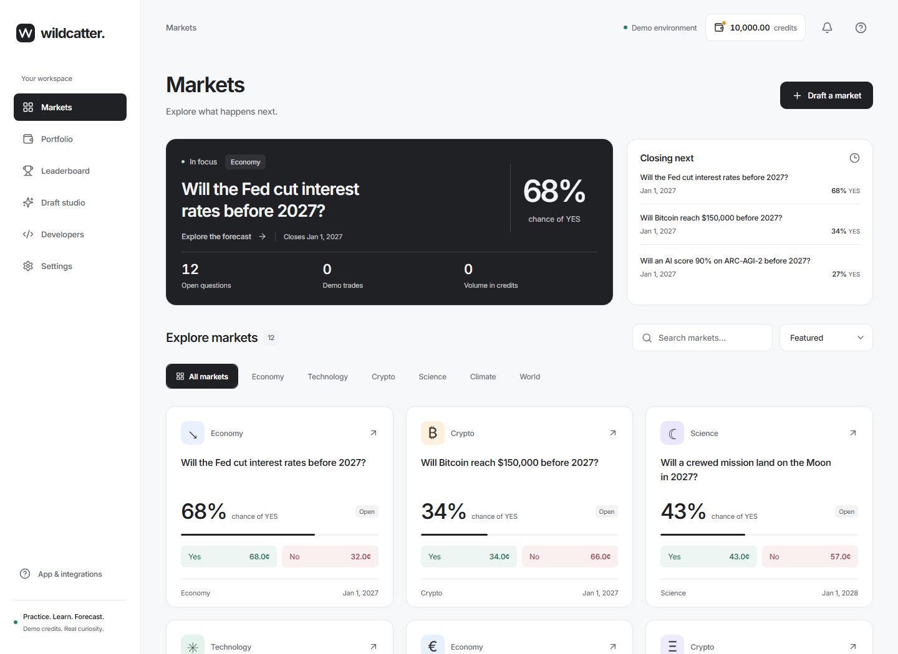
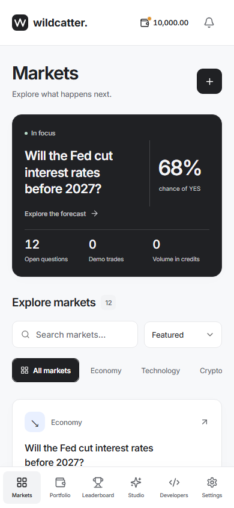

# Wildcatter

**An AI-native prediction market platform.** Anyone can draft a market with AI help, launch it with their own staked liquidity, trade it, and see it resolved through a transparent propose, dispute and rule process, on the web, as an installable mobile app, and as a Windows desktop app, all on one backend and one public API.

**Live demo:** https://wildcatter-p3yy.onrender.com · **API reference:** https://wildcatter-p3yy.onrender.com/api-docs/ · **Windows app:** [latest release](https://github.com/vinitgirdhar/wildcatter/releases/latest)



A quiet forecasting workspace: crisp typography, a persistent desktop sidebar, and a touch-friendly mobile tab bar. A compact market pulse shows open questions, actual demo activity and upcoming deadlines. The hero offers the web app, Windows desktop download and Android download together. Light and dark appearances, hidden scrollbars that preserve scrolling, section reveals, sliding selections, animated charts and values, expanding panels, and tactile controls work across the shared frontend, with reduced-motion support.

> Wildcatter runs on demo credits. Every account starts with 10,000 credits; nothing here is real money, a wallet, or an on-chain asset. See [Scope and honesty](#scope-and-honesty).

## Contents

- [What it does](#what-it-does)
- [Design principles](#design-principles)
- [Delivery phases](#delivery-phases)
- [Architecture](#architecture)
- [Run it locally](#run-it-locally)
- [Apps: web, mobile, Windows](#apps-web-mobile-windows)
- [Developer API](#developer-api)
- [Quality and verification](#quality-and-verification)
- [Deployment](#deployment)
- [Scope and honesty](#scope-and-honesty)
- [Documentation](#documentation)

## What it does

### Trade

- Search, filter and sort markets; each shows its YES probability, 24-hour change, volume and deadline.
- Buy and sell YES/NO shares against an LMSR automated market maker with live quotes, a price-impact breakdown and a slippage limit.
- **Limit orders**: name a price and the order fills by itself when the market reaches it.
- Portfolio with positions, profit and loss, trade activity, open orders, watchlist, performance stats and a downloadable CSV statement.

### Create

- **Draft studio**: write a market by hand or let an AI provider (Gemini, Groq, OpenAI or local Ollama) tighten the question and the YES / NO / invalid rules. The source and deadline you set are protected from the model.
- **Creator markets**: launch a draft as a live market by staking 500 credits of liquidity. The creator earns a 1% fee on every trade and gets unused liquidity back at resolution. The stake fully covers the market maker's worst-case loss, so every payout is funded.

### Resolve

An optimistic-oracle lifecycle, the part most demo markets skip:

1. **Propose.** The creator posts an outcome (YES, NO or INVALID) with an evidence link. Trading halts.
2. **Challenge window.** Anyone else may dispute by posting a 100-credit bond.
3. **Settle.** Undisputed proposals pay out automatically when the window ends.
4. **Rule.** Disputed markets wait for an operator ruling. An overturned creator pays the disputer; an upheld one keeps the bond.

Winning shares redeem for 1 credit, INVALID pays 0.5 on both sides, and every credit movement is written to a per-account ledger.

### Engage

- Public trade feed and discussion on every market; comments show which side the commenter holds.
- Leaderboards for top traders (by profit) and top creators (by fees). Traders appear under an alias, never an account id.
- Notifications inbox for fills, payouts, proposals, disputes and comments.
- Daily bonus with a streak. Bonus credits are excluded from profit rankings.

## Design principles

1. **Every payout is funded.** Creator liquidity equals the LMSR worst-case loss, so a market can never owe more than it holds. A test asserts that credits are conserved across a full market lifecycle.
2. **Money is integers.** All amounts are integer microcredits (1 credit = 1,000,000). No floating-point balances.
3. **One atomic write per action.** A trade, its fee, the position change and the ledger row commit together or not at all. Retries are safe through idempotency keys.
4. **AI assists, humans decide.** Models refine wording only. They cannot publish a market, trade, or settle an outcome, and their output is schema-validated before it is saved.
5. **Resolution is a process, not a button.** Outcomes need evidence, can be challenged, and disputes cost a bond, so lying is expensive for both sides.
6. **Private by default.** Account ids never leave the server; public surfaces use stable aliases. Provider keys stay server-side and are never returned by the API.
7. **One API for everyone.** The web app, the desktop app and third-party builders use the same versioned HTTP API and the same typed client.
8. **Claims are tested.** Each feature ships with automated checks, and the docs state what is not covered.

## Delivery phases

| Phase | Theme                                                                                                                             | Status  |
| ----- | --------------------------------------------------------------------------------------------------------------------------------- | ------- |
| 1     | Exchange core: accounts, AMM pricing, atomic trades, portfolio, price history                                                     | Done    |
| 2     | Creation: draft studio, AI rule refinement across four providers, creator markets with staked liquidity and fees                  | Done    |
| 3     | Resolution: proposals with evidence, challenge window, bonded disputes, operator rulings, automatic settlement, credit ledger     | Done    |
| 4     | Product depth: limit orders, discussion, watchlist, leaderboards, notifications, daily bonus, performance stats, statement export | Done    |
| 5     | Surfaces: responsive web, installable mobile PWA, Windows desktop app, public API with OpenAPI and typed SDK, hosted demo         | Done    |
| 6     | Real settlement: wallet connectivity, collateral vault and conditional tokens on an L2 testnet, a full order book                 | Planned |
| 7     | Autonomy and compliance: news ingestion and market generation agents, multi-source oracle, KYC and geofencing, fiat rails         | Planned |

The requirement-by-requirement record against the original brief is in [docs/RFP_STATUS.md](docs/RFP_STATUS.md).

## Architecture

```
            Web app            Mobile PWA           Windows app (Electron)
               \                  |                   /
                +------ shared React UI (src/) ------+
                               |
                   typed client (shared/client.ts)
                               |
                     HTTP API  /api/v1  (Fastify 5)
        +-----------+-----------+-----------+-----------+
        | trading   | creation  | resolution| community |
        | AMM,orders| drafts,AI | disputes  | feed,inbox|
        +-----------+-----------+-----------+-----------+
                               |
                     SQLite (node:sqlite), one file
```

| Folder     | Contents                                                                                    |
| ---------- | ------------------------------------------------------------------------------------------- |
| `src/`     | Shared React 19 UI used by web, PWA and desktop                                             |
| `server/`  | Fastify API, SQLite transactions, AMM, limit orders, resolution, notifications, AI adapters |
| `shared/`  | API types and the TypeScript client used by the UI and by integrators                       |
| `desktop/` | Electron shell: sandboxed renderer, bundled local API                                       |
| `tests/`   | Unit and integration tests (`node:test`) and Playwright browser journeys                    |
| `scripts/` | Verification pipeline, API smoke test, desktop packaging and smoke test                     |
| `docs/`    | API guide, backend guide, design system, plan, RFP status                                   |

**Stack:** TypeScript, Node.js 22 (`node:sqlite`), Fastify 5 with TypeBox schemas, React 19, Vite 8, Electron, Playwright.

## Run it locally

Requires Node.js 22.13 or newer.

```bash
npm ci
npm run build
npm start
```

Open http://127.0.0.1:3001 for the app and http://127.0.0.1:3001/api-docs/ for the interactive API reference. Use `npm run dev` for hot reload.

Optional settings go in `.env` (copy `.env.example`): AI provider keys, `AI_ACCESS_TOKEN` to gate paid AI calls, `OPERATOR_TOKEN` (16 to 256 characters) to enable operator rulings, and `DISPUTE_WINDOW_SECONDS`. Never commit `.env`.

## Apps: web, mobile, Windows

| Surface                  | How to get it                                                                                                                                             | Data                                                                |
| ------------------------ | --------------------------------------------------------------------------------------------------------------------------------------------------------- | ------------------------------------------------------------------- |
| Web                      | The live demo, or `npm start` locally                                                                                                                     | The server it talks to                                              |
| Mobile (Android and iOS) | Open the live demo on the phone and choose **Install app** / **Add to Home Screen**. The PWA runs full screen with its own icon.                          | Same hosted backend as the web demo                                 |
| Windows desktop          | Download the ZIP from the [latest release](https://github.com/vinitgirdhar/wildcatter/releases/latest), extract the whole folder and run `Wildcatter.exe` | Its own bundled local API and database under `%APPDATA%/wildcatter` |

The desktop app is self-contained: it starts its own local server and needs no internet connection except for optional AI providers. Build it yourself with `npm run desktop:package`. The preview executable is unsigned, so Windows SmartScreen may ask for confirmation.

The landing page also offers an Android APK when its download is available. Build the Android shell with `powershell -File scripts/build-android.ps1` (Android SDK 35 and JDK 17 required). It defaults to the hosted demo; use `-Origin https://your-host.example` for a different host. The APK loads the shared frontend from that origin, so local UI changes require deployment there before they appear in the installed app.



The [interface guide](docs/DESIGN.md) covers typography, spacing, navigation, motion and platform behavior. See the [landing page preview](docs/assets/landing-desktop.png). Run `npm run review:ui` to capture light and dark screenshots and check accessibility across all app routes.

## Developer API

Everything the UI does is available over `/api/v1`. Create a session to get a bearer token, then trade:

```bash
curl -X POST https://wildcatter-p3yy.onrender.com/api/v1/sessions
curl https://wildcatter-p3yy.onrender.com/api/v1/markets
```

- Guide with every route, status code and rule: [docs/API.md](docs/API.md)
- Interactive reference and OpenAPI document: `/api-docs/` and `/api/v1/openapi.json`
- Typed client: [`shared/client.ts`](shared/client.ts)

## Quality and verification

One command runs the whole gate:

```bash
npm run verify
```

It checks formatting and documentation links, runs the unit and integration suite with an 80% coverage gate (currently about 97% of lines), builds the project, smoke-tests the live HTTP API, runs the Playwright journeys on desktop Chromium, mobile Chromium and mobile WebKit, and audits dependencies. The same pipeline runs in GitHub Actions on every push.

Tested behaviours include fee arithmetic, conservation of credits through resolution, idempotent retries, dispute outcomes, limit-order matching, privacy of account ids, and a full browser journey from launching a market to an operator ruling.

## Deployment

The repository includes a Render blueprint ([render.yaml](render.yaml)). The hosted demo runs on Render's free plan, which means:

- the service sleeps when idle, so the first request can take up to a minute;
- the database is on an ephemeral disk, so accounts and trades reset on each deploy. Sample markets are recreated at start.

The server only answers on its own public origin and rejects cross-origin browser requests.

## Scope and honesty

Implemented and tested: everything under [What it does](#what-it-does).

Not implemented: real money, wallets, on-chain settlement, a visible order book or partial fills, autonomous market generation from news, automated evidence checking, identity verification and geofencing. Operator rulings are a trusted human step. Sample markets and their starting probabilities are illustrative, not live data.

## Documentation

| Topic                                 | Document                                                                               |
| ------------------------------------- | -------------------------------------------------------------------------------------- |
| Status against the original brief     | [docs/RFP_STATUS.md](docs/RFP_STATUS.md)                                               |
| HTTP API                              | [docs/API.md](docs/API.md)                                                             |
| Server modules and transaction safety | [docs/BACKEND.md](docs/BACKEND.md)                                                     |
| Design system                         | [docs/DESIGN.md](docs/DESIGN.md)                                                       |
| Acceptance checklist                  | [docs/ACCEPTANCE.md](docs/ACCEPTANCE.md)                                               |
| Verification record and automation    | [docs/VERIFICATION.md](docs/VERIFICATION.md), [docs/AUTOMATION.md](docs/AUTOMATION.md) |
| Plan and research                     | [docs/PLAN.md](docs/PLAN.md), [docs/RESEARCH.md](docs/RESEARCH.md)                     |
