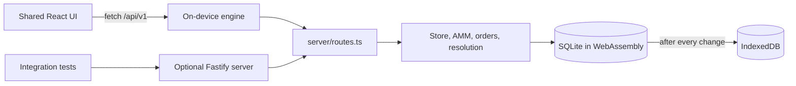

# Data and engine guide

Status: the Store, pricing, orders and resolution run **inside each app** (web, Android, Windows) on SQLite compiled to WebAssembly. The same code also runs as an optional Fastify server, used by the integration tests. This is a practice app, not the decentralized production exchange described in the RFP.

## Entry points and ownership

| File                                                 | Responsibility                                                                                                                       |
| ---------------------------------------------------- | ------------------------------------------------------------------------------------------------------------------------------------ |
| `src/local/index.ts`                                 | Starts the on-device engine before the UI, routes the app's `/api/` fetches to it, saves the database to IndexedDB after each change |
| `src/local/engine.ts`                                | Builds the engine: the Store on sql.js plus the shared routes; teams, share links and operator rulings are off                       |
| `src/local/router.ts`                                | The slice of Fastify the routes use: matching, TypeBox validation, response cleaning and the server's error messages                 |
| `src/local/sqlite.ts`                                | The `node:sqlite` `DatabaseSync` API on sql.js (WebAssembly)                                                                         |
| `src/local/node-crypto.ts`, `src/local/node-fs.ts`   | Browser stand-ins for the Node built-ins the shared code imports; the SHA-256 is checked against `node:crypto` in tests              |
| `server/routes.ts`                                   | Every `/api/v1` route: authorization, schemas and handlers; registered by both the app engine and the Node server                    |
| `server/app.ts`, `server/index.ts`                   | Optional Node server: Fastify, security headers, rate limits, OpenAPI, embeds and static files                                       |
| `server/database.ts`                                 | SQLite tables, account isolation, transactional execution, positions, trade history and private drafts                               |
| `server/drafts.ts`                                   | Draft validation: schema, public HTTPS source, future deadline                                                                       |
| `server/resolution.ts`                               | Outcome proposal, challenge window, bonded disputes, operator rulings, payouts and creator liquidity return                          |
| `server/orders.ts`                                   | Limit orders: placement, cancellation and matching against the AMM after each trade                                                  |
| `server/community.ts`                                | Market comments (with the side each commenter holds) and per-account watchlist                                                       |
| `server/notifications.ts`                            | Per-account notification inbox, written in the same transaction as the event where one exists                                        |
| `server/engagement.ts`                               | Daily bonus with streak and portfolio performance stats                                                                              |
| `server/calibration.ts`                              | Brier score, crowd-baseline skill and calibration buckets                                                                            |
| `server/workspaces.ts`, `server/workspace-routes.ts` | Teams; registered only by the Node server                                                                                            |
| `server/amm.ts`                                      | One LMSR quote implementation used by quotes and executions                                                                          |
| `server/schemas.ts`                                  | Runtime input and output contracts                                                                                                   |
| `server/fixtures.ts`                                 | Twelve illustrative scenarios and initial probabilities; no live event feed                                                          |
| `shared/types.ts`, `shared/client.ts`                | Client-facing types and the SDK used by the UI                                                                                       |
| `shared/lint.ts`, `shared/explain.ts`                | Rule linter and plain-language market facts; pure functions                                                                          |
| `desktop/main.mjs`                                   | Electron shell serving `dist/` from `app://peakcast`                                                                                 |
| `android/MainActivity.java`                          | WebView shell serving the bundled `dist/` from `https://appassets.androidplatform.net`                                               |

## Startup and persistence

On launch, `startOnDeviceApi()` loads the SQLite WebAssembly module and the saved database bytes from IndexedDB (database `peakcast`, store `files`), then renders the UI. A new device starts with an empty database: tables are created and the twelve sample markets inserted. Startup never resets an existing account or trade history.

Every request that changes data is saved before its response reaches the UI: the engine exports the whole database and writes it to IndexedDB, one save at a time, so closing the app right after a trade cannot lose it. The 15-second automatic settlement sweep saves the same way. The app asks the browser for persistent storage so the data is not evicted under storage pressure; clearing site data or uninstalling the app erases it. Accounts expire after 30 days without use, and using the app renews the expiry.

The optional Node server keeps its database in `data/peakcast.sqlite` (`DATABASE_PATH` overrides it) with WAL mode, foreign keys and a busy timeout. Stop it before copying the database together with any `-wal`/`-shm` sidecars. Production migrations are not implemented.

## Quote-to-trade path

1. Validate market ID, outcome, action and whole share count (1–10,000).
2. Quote from the current market inventory and liquidity parameter; reject closed markets.
3. Authenticate the execution using the hash of its random bearer credential.
4. Begin `BEGIN IMMEDIATE`; check the account-scoped idempotency key before changing balances.
5. Identical key/input returns the original fill. Different input with the same key returns 409.
6. Recalculate the executable quote. Enforce maximum buy cost or minimum sell proceeds, then check balance or owned shares.
7. Update position/cost basis, balance, market inventory/volume and trade history in the same transaction. Commit all or roll back all.

Costs/balances use integer microcredits: 1 credit = 1,000,000 units. Shares are whole numbers; the LMSR inventory/curve uses floating-point arithmetic. Buy cost rounds up and sell proceeds round down to prevent credit creation through a round trip. This is demo accounting, not an audited double-entry financial ledger.

The UI caps a buy's optional 1% adverse-price allowance at the available balance and API limit. It cannot spend more than the submitted maximum. Interrupted trade responses retain the same key/payload for an in-page confirmation retry. Reopening a page does not restore a pending request; inspect trade activity before manually creating another order after an uncertain reload.

## Accounts and security boundaries

- Demo credentials are random 32-byte tokens, hashed in storage, and expire after 30 days. Each account's portfolio/drafts query is scoped to its authenticated ID.
- Browser demo credentials are stored in localStorage so the SDK and Copy API Token control can access them. This is a documented demo shortcut; production needs a deliberate identity/session and developer-key design. A strict script CSP and React text escaping reduce, but do not eliminate, XSS risk.
- SQL uses bound parameters. JSON bodies are limited to 16 KiB. Input types, allowed fields, enums and ranges are validated before execution.
- Hosts default to `127.0.0.1`/`localhost`. An optional `PUBLIC_ORIGIN` on the web server allows one exact HTTPS preview host, with a matching HTTPS origin; it does not enable arbitrary CORS or change the desktop app. API responses use `Cache-Control: no-store`. This is not regulatory country geofencing.
- On the optional Node server, the default per-IP API limit is 300/minute and session creation 10/minute. Rate limits run in memory and are not shared between processes.

## Workspaces: wallets and the gate

Teams adds three tables (`workspaces`, `workspace_members`, `workspace_invites`) and a nullable `workspace_id` column on `markets` and `accounts`. Startup adds the columns to an existing database with the same `PRAGMA table_info` + `ALTER TABLE` loop as earlier columns and creates their indexes only after that loop; no data is rewritten. Public markets keep `workspace_id = NULL` and follow exactly the code paths they did before.

- **Wallets.** Each membership owns an ordinary `accounts` row with `workspace_id` set, funded with 10,000 workspace credits (personal accounts start with 5,000). Positions, trades, orders, ledger, watchlist, comments and notifications are all keyed by account id, so they become workspace-scoped with no new column and no change to the money paths; `payOut` conservation still holds per market. A wallet's `token_hash` is `wallet:<id>`, which can never equal a SHA-256 digest, so no bearer token authenticates as a wallet. `Store.handle()` shows the member's display name for a wallet, and the generic alias otherwise.
- **The gate.** `marketActor(store, personId, marketId)` runs first in every market route. For a public market it returns the person (or `undefined` for an anonymous read). For a private market it returns the caller's active wallet, and throws the unknown-market 404 for everyone else. Writes then act as that account. `DELETE /orders/{id}` resolves the order's market the same way. Embeds, oEmbed and link-preview tags call the gate with no viewer, so private markets are never previewable, and the operator ruling route refuses them.
- **Filters.** `Store.markets()`, `Store.leaderboard()` and the accuracy board take a `workspaceId` that defaults to `null`, and filter with `workspace_id IS ?`, which matches NULL correctly. Public lists, `marketCount`, the public leaderboard and the forecaster board therefore see public markets and person accounts only; the workspace variants see one workspace. The inbox reads the person's own rows plus those of their active wallets, so removing a member hides private notifications immediately.
- **Tests.** `tests/isolation.test.ts` reads the OpenAPI document and calls every market- and workspace-scoped route as an outsider and anonymously, asserting the response equals the one for an unknown id; a new route missing from its table fails the test. It also scans every public read for private ids, titles, workspace and member names, and checks that wallets cannot authenticate.

## Verification and production gaps

`npm run verify` builds the shipped code and checks it over real loopback HTTP with the SDK and a disposable database. Browser journeys run the built web app with its on-device engine and disposable browser storage. Rate-limit behavior is tested separately with limits enabled.

See [API reference](API.md), [review checklist](ACCEPTANCE.md), [automation](AUTOMATION.md), and [RFP status](RFP_STATUS.md). Production gaps include a double-entry ledger, order reservations/CLOB, on-chain collateral/tokens, reconciliation/finality, oracle disputes/payouts, wallet identity, fiat/KYC integrations, scoped/revocable production keys, backups/migrations and measured capacity/security audits.
