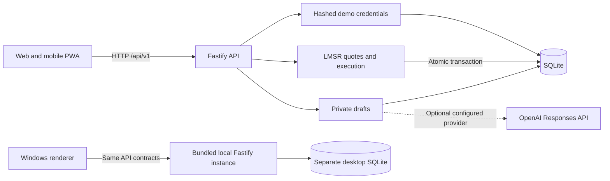

# Backend implementation guide

Status: working **local demo backend**, not the decentralized production exchange described in the RFP. The browser/PWA and Windows renderer call HTTP APIs; balances and positions are not client-side simulations.

## Entry points and ownership

| File                                   | Responsibility                                                                                                                          |
| -------------------------------------- | --------------------------------------------------------------------------------------------------------------------------------------- |
| `server/index.ts`                      | Load server environment, build application, bind loopback and close on termination                                                      |
| `server/app.ts`                        | Fastify routes, bearer authorization, input/response schemas, origin rules, limits, error responses, OpenAPI and static client delivery |
| `server/database.ts`                   | SQLite tables, account isolation, transactional execution, positions, trade history and private drafts                                  |
| `server/resolution.ts`                 | Outcome proposal, challenge window, bonded disputes, operator rulings, payouts and creator liquidity return                             |
| `server/orders.ts`                     | Limit orders: placement, cancellation and matching against the AMM after each trade                                                     |
| `server/community.ts`                  | Market comments (with the side each commenter holds) and per-account watchlist                                                          |
| `server/notifications.ts`              | Per-account notification inbox; written by orders, resolution and comments in the same transaction as the event where one exists        |
| `server/engagement.ts`                 | Daily bonus with streak (derived from `daily_bonus` ledger rows) and portfolio performance stats                                        |
| `server/amm.ts`                        | One LMSR quote implementation used by quotes and executions                                                                             |
| `server/ai.ts`                         | Optional provider call, strict structured output, protected source/deadline checks and output validation                                |
| `server/schemas.ts`                    | Runtime input/output contracts and generated error schemas                                                                              |
| `server/fixtures.ts`                   | Twelve illustrative scenarios and initial probabilities; no live event feed                                                             |
| `shared/types.ts` / `shared/client.ts` | Client-facing types and the SDK used by the web UI                                                                                      |
| `desktop/main.mjs`                     | Sandboxed renderer plus a separately persisted local API instance                                                                       |

## Startup and persistence

The web database defaults to `data/wildcatter.sqlite`; `DATABASE_PATH` overrides it. Startup creates missing tables and inserts sample markets only when there are no markets. It never resets an existing account or trade history. WAL mode, foreign keys and a busy timeout are enabled.

The desktop store lives under Electron's application-data directory, normally `%APPDATA%/wildcatter/wildcatter.sqlite`, and binds port 43127. Browser and desktop demo accounts are separate local stores. Shared hosted identity and cross-device portfolio synchronization are future work.

Before rebuilding a running local production server, stop it and restart after `npm run build`: the static routes are registered for the built asset filenames at startup. Do not delete the database to refresh the frontend.

For backup, stop the owning API/app cleanly before copying the SQLite database and any remaining `-wal`/`-shm` sidecars together. A live-copy backup/restore workflow and production migrations are not implemented. Never copy only a live `.sqlite` file and assume all committed WAL writes are included.

## Quote-to-trade path

1. Validate market ID, outcome, action and whole share count (1–10,000).
2. Quote from the current market inventory and liquidity parameter; reject closed markets.
3. Authenticate the execution using the hash of its random bearer credential.
4. Begin `BEGIN IMMEDIATE`; check the account-scoped idempotency key before changing balances.
5. Identical key/input returns the original fill. Different input with the same key returns 409.
6. Recalculate the executable quote. Enforce maximum buy cost or minimum sell proceeds, then check balance or owned shares.
7. Update position/cost basis, balance, market inventory/volume and trade history in the same transaction. Commit all or roll back all.

Costs/balances use integer microcredits: 1 credit = 1,000,000 units. Shares are whole numbers; the LMSR inventory/curve uses floating-point arithmetic. Buy cost rounds up and sell proceeds round down to prevent credit creation through a round trip. This is demo accounting, not an audited double-entry financial ledger.

The UI caps a buy's optional 1% adverse-price allowance at the available balance and API limit. It cannot spend more than the submitted maximum. Interrupted trade responses retain the same key/payload for an in-page confirmation retry. Reopening a page does not restore a pending request; inspect trade activity before manually creating another order after an uncertain reload.

## Accounts and security boundaries

- Demo credentials are random 32-byte tokens, hashed in storage, and expire after 30 days. Each account's portfolio/drafts query is scoped to its authenticated ID.
- Browser demo credentials are stored in localStorage so the SDK and Copy API Token control can access them. This is a documented demo shortcut; production needs a deliberate identity/session and developer-key design. A strict script CSP and React text escaping reduce, but do not eliminate, XSS risk.
- SQL uses bound parameters. JSON bodies are limited to 16 KiB. Input types, allowed fields, enums and ranges are validated before execution.
- Hosts default to `127.0.0.1`/`localhost`. An optional `PUBLIC_ORIGIN` on the web server allows one exact HTTPS preview host, with a matching HTTPS origin; it does not enable arbitrary CORS or change the desktop app. API responses use `Cache-Control: no-store`. This is not regulatory country geofencing.
- The default per-IP API limit is 300/minute, session creation 10/minute, AI generation 3/minute. Rate limits run in memory and are not shared between processes.
- Provider keys stay on the server. AI generation needs both a demo credential and the extra AI access secret. Generic provider errors do not reveal upstream details.

## AI lifecycle

Manual save works without provider credentials. Optional AI receives only the submitted draft JSON and an instruction to treat it as untrusted data. It refines rules through structured output; the server rejects incomplete/refused/malformed output, missing fields, and changed designated source or deadline. Invalid generated data returns 502 rather than blaming the user's valid input with a 400.

The automated tests exercise the real SDK/provider adapter against mocked HTTP responses. They do not prove a paid model's availability, accuracy, current event knowledge, data rights or factual verification. No news is fetched. No model can publish a market, trade or settle a position.

## Verification and production gaps

`npm run verify` builds the shipped code and checks it over real loopback HTTP with the SDK and a disposable database. Browser journeys use the compiled backend with disposable data and no live AI credentials. Rate-limit behavior is tested separately with limits enabled.

See [API reference](API.md), [review checklist](ACCEPTANCE.md), [automation](AUTOMATION.md), and [RFP status](RFP_STATUS.md). Production gaps include a double-entry ledger, order reservations/CLOB, on-chain collateral/tokens, reconciliation/finality, oracle disputes/payouts, wallet identity, fiat/KYC integrations, scoped/revocable production keys, backups/migrations and measured capacity/security audits.

## Multiple AI providers

`server/ai.ts` owns Gemini REST, Groq OpenAI-compatible chat, and the optional OpenAI Responses integration. `GET /api/v1/capabilities` exposes configured provider IDs, labels and model names without keys. The generate route accepts a validated `provider` query parameter, requires account bearer plus workspace access token, and records the provider on the saved JSON draft. No database migration is required for historical `openai`/`manual` drafts. No automatic provider fallback, tool execution or source retrieval occurs. HTTP credentials stay in headers to fixed HTTPS endpoints; bounded output and timeouts limit each request. Backend setup lives in the ignored `.env`; packaged Electron archives exclude `.env` and use their own runtime environment.
